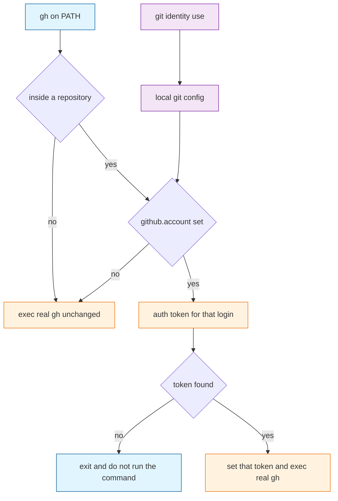

# Task: gh account pin

* Task ID: gh-account-pin
* Complexity: Level 3
* Type: feature

`git identity use` records the GitHub login for a checkout. A `gh` shim on `PATH` forces that login's token for the real `gh`. Linked worktrees read the same local git config. The approach is the one in `memory-bank/active/creative/creative-gh-account-per-checkout.md`.

Real GitHub logins, SSH hosts, account names, and tokens do not appear in this repository. Tests and docs use placeholders such as `example-login` and `ghe.example`. Tests stub `gh`. They do not run the operator's real `gh`, read `~/.config/gh`, or install into the operator's real home.

## Pinned Info

### How a gh command picks its token

The shim is the `gh` on `PATH`. The pin is local git config, which a linked worktree already shares with the core checkout.

## Component Analysis

### Affected Components

- `subcommands/git-identity/git-identity.bash`: applies an identity file to the current checkout. Gains `@gh-account` and `@gh-host`. Clears those keys when the identity file omits them.
- `shims/gh.sh`: new POSIX shim, installed as `~/.local/bin/gh`. Reads the pin and execs the real `gh`.
- `scripts/install-subcommands.sh`: copies git subcommands into `~/.local/bin` and writes their cat pages. Also installs, parks, and uninstalls the shim. `make`, `make subcommands`, and `make clean` already call this script.
- `subcommands/git-identity/README.md`: documents identity directives.
- `memory-bank/productContext.md` and `memory-bank/systemPatterns.md`: one sentence each so the product picture and the install story stay true.

### Cross-Module Dependencies

- `git identity use` writes `github.account` and `github.host`. It does not call `gh`.
- The shim reads those keys with `git config --local --get` after it knows the directory is a repository. It does not call `git identity`. A global or system key is not a pin.
- The installer copies `shims/gh.sh` to `~/.local/bin/gh`. The shim then finds the real binary at `~/.local/libexec/git-aliases/gh` or as the next `gh` on `PATH`.
- `@hostname` still rewrites SSH remotes inside `git-identity`. The shim does not read that alias.

### Boundary Changes

- Identity files gain two optional directives, `@gh-account` and `@gh-host`.
- Default install adds `~/.local/bin/gh`. A foreign file already at that path is moved to `~/.local/libexec/git-aliases/gh`.
- No git config schema beyond the two local keys. Plain `git config`, never `git config --worktree`.

### Invariants & Constraints

- A pin with no stored token must not fall through to the active account.
- The shim must not call `gh auth switch` and must not print a token.
- No local pin, and not a repository, both leave the environment unchanged. A global `github.account` is not a pin.
- `@hostname` is not passed as `--hostname`. The shim does not export `GH_HOST`. An SSH alias remote keeps working. A command that does not infer a host from the remote still follows the ambient `GH_HOST`.
- A `gh` whose file contains the marker `git-aliases-gh-shim` is never the real binary, including when `$0` is a bare `gh`.
- Tests and build verification stay inside a fake `HOME`. Do not run `make`, `make subcommands`, or `make clean` against the operator's real home.
- Placeholders only. No real identities in source, tests, docs, or the memory bank.
- Linux and macOS. No `cmd` or PowerShell shim in this pass.
- No new runtime dependency.

## Open Questions

- [x] How should a checkout force `gh` onto one account, including worktrees, without a shell hook? → Resolved: PATH shim plus `github.account` written by `git identity` (see `memory-bank/active/creative/creative-gh-account-per-checkout.md`)
- [x] Does the implementation live in this repository? → Resolved: yes. The accepted design changes `git identity`, which is this product.

None unresolved.

## Test Plan (TDD)

### Behaviors to Verify

- `git identity use` with `@gh-account example-login` → `github.account` is `example-login`
- `git identity use` of an identity with no `@gh-account`, after a pin was set → `github.account` is unset
- `@gh-host ghe.example` → `github.host` is `ghe.example`, and a later identity with no `@gh-host` unsets it
- `@hostname vanity.example` on an SSH remote → the remote host becomes `vanity.example` and `github.host` stays unset
- `@gh-account ""`, a bare `@gh-account`, `@gh-host ""`, and a bare `@gh-host` → `git identity use` exits non-zero and does not write any key from that file, including an earlier `user.email`
- Identity with no `@gh-account` and no existing key → `git identity use` exits 0
- `git identity use` on the core checkout → a linked worktree's `git config --local --get github.account` returns the same login
- Shim, repository, no local pin, `GH_TOKEN` already set → the stub `gh` sees that same `GH_TOKEN` and the original arguments
- Shim, repository, no local pin, global config file sets `github.account` to `example-login`, ambient `GH_TOKEN` set → ambient `GH_TOKEN` is preserved and `auth token` is not run
- Shim, not a repository, same global key, ambient `GH_TOKEN` set → same passthrough, and stdout is only what the stub printed. The repo probe does not print `true`
- Shim, pin `example-login`, ambient `GH_TOKEN` and `GITHUB_TOKEN` set → lookup is `auth token --user example-login` with no `--hostname`; the command runs with `GH_TOKEN` and `GH_ENTERPRISE_TOKEN` both equal to the stub token, and `GITHUB_TOKEN` and `GITHUB_ENTERPRISE_TOKEN` empty
- Shim, local `github.account` set, local `github.host` unset, global config sets `github.host` to `ghe.example` → lookup has no `--hostname`
- Shim, pin whose token lookup exits non-zero → shim exits non-zero, stderr names the login, the requested command is not run, stdout has no token
- `github.host` is `ghe.example` → lookup includes `--hostname ghe.example`, the command runs with both token variables set to the stub token, and an ambient `GH_HOST` is unchanged
- `github.host` is `example.ghe.com` → lookup includes `--hostname example.ghe.com`, and both token variables are set to the stub token
- Remote host is `vanity.example` and `github.host` is unset → lookup has no `--hostname`
- Pin set on the core checkout, shim invoked in the linked worktree → the stub sees that login
- `~/.local/libexec/git-aliases/gh` exists, has no shim marker, and another `gh` is later on `PATH` → the libexec binary is the one invoked
- The shim is invoked as bare `gh` with `PATH` set to the shim directory then the stub directory → the stub runs once. A libexec file that contains the shim marker is skipped
- Stub treats `auth switch` as a failure if it is ever invoked
- Install under a fake home → `~/.local/bin/gh` is the shim and is executable
- Install when `~/.local/bin/gh` is a foreign file → that file's bytes move to `~/.local/libexec/git-aliases/gh` and `~/.local/bin/gh` is the shim
- Install again → the parked bytes are unchanged
- Install when a foreign `~/.local/bin/gh` and a parked file both exist → installer exits non-zero and both files stay
- Uninstall after a park → shim is gone and the parked bytes are back at `~/.local/bin/gh`
- Uninstall when `~/.local/bin/gh` is foreign and nothing is parked → that file stays

### Test Infrastructure

- Framework: the repo's POSIX shell suites (`set -eu`, `run_isolated`, fake `HOME`, `GIT_CONFIG_GLOBAL=/dev/null`)
- Test location: `tests/`
- Conventions: one `test_*` function per behavior, `run_one` from `main`, placeholders only, copy the script under test onto a temp `PATH` and `chmod +x` it. `tests/test-git-identity.sh` and `tests/test-install-subcommands.sh` are the patterns. Do not add a shunit2 suite for this feature.
- New test files: `tests/test-gh-shim.sh`
- Existing files that gain cases: `tests/test-git-identity.sh`, `tests/test-install-subcommands.sh`
- `Makefile` `test` target must run `tests/test-gh-shim.sh`

### Integration Tests

- Worktree pin: `git identity use` on the core checkout, then the shim in the linked worktree, against a stub `gh`
- Installer copies `shims/gh.sh` and the shim's libexec-versus-PATH rule. The install tests stay in the fake home and use a foreign stand-in file, not a real `gh` binary

## Implementation Plan

### 1. git-identity directives — executable (done)

- Files: `tests/test-git-identity.sh`, `subcommands/git-identity/git-identity.bash`
- Creative ref: `memory-bank/active/creative/creative-gh-account-per-checkout.md`

1. Stub tests: add `test_use_sets_github_account`, `test_use_without_gh_account_clears_pin`, `test_use_sets_github_host`, `test_hostname_does_not_set_github_host`, `test_gh_account_empty_fails`, `test_bare_gh_account_fails`, `test_gh_host_empty_fails`, `test_bare_gh_host_fails`, `test_use_without_pin_exits_zero`, and `test_worktree_sees_github_account`, each with an empty body, and call them from `run_one`.
2. Stub interface: in `process_directive`, add `gh-account` and `gh-host` arms that return without writing config. In `use_identity`, add the two "directive was seen" flags, still unused. A first pass over the file rejects a bare or empty `@gh-account` or `@gh-host` before the apply loop.
3. Write tests and run red: drive `git identity use` against identity files created inside the isolated home. Assert the `github.account` and `github.host` outcomes above, including the worktree read, all four empty forms, a file whose `user.email` line sits above a bare directive and must not be applied, and a use that unsets nothing and still exits 0. Run `tests/test-git-identity.sh` and see the new cases fail.
4. Write code and run green: scan the identity file first. A bare or empty `@gh-account` or `@gh-host` exits non-zero and leaves the checkout untouched. Then apply the file. `gh-account` runs `git config --replace-all github.account` with the login. `gh-host` does the same for `github.host`. After that, a missing `@gh-account` runs `git config --unset github.account || true`, and a missing `@gh-host` unsets `github.host` the same way, before the success message. Update the `create` template with commented placeholder directives. Do not assert on the template text. Run `tests/test-git-identity.sh` until the new cases and the existing ones pass.

### 2. gh shim — executable (done)

- Files: `tests/test-gh-shim.sh`, `shims/gh.sh`, `Makefile`
- Creative ref: `memory-bank/active/creative/creative-gh-account-per-checkout.md`

1. Stub tests: create `tests/test-gh-shim.sh` in the same isolated-home style as `tests/test-git-identity.sh`. Add empty cases for the shim behaviors listed above, including the global account key, the global host key, libexec precedence, the marker skip, the vanity remote, both host forms, the missing token, the worktree, and passthrough stdout. Add the file to the `Makefile` `test` target.
2. Stub interface: add `shims/gh.sh` with `#!/bin/sh`, the marker comment `git-aliases-gh-shim`, and empty `resolve_real_gh`, `exec_real`, and `main`. Follow `shell-posix-style`. The installed name has no extension. The source name is `gh.sh` so ShellCheck sees it.
3. Write tests and run red: the stub `gh` on `PATH` records arguments and `GH_TOKEN`, `GITHUB_TOKEN`, `GH_ENTERPRISE_TOKEN`, `GITHUB_ENTERPRISE_TOKEN`, and `GH_HOST` under the fake home. `auth token --user example-login` prints `test-token`. `auth token --user missing-login` exits 1. Any `auth switch` exits 1. For the global account case, point `GIT_CONFIG_GLOBAL` at a file that sets `github.account`, and do not set the local key. For the global host case, set local `github.account` and put `github.host` only in that global file. One case invokes the shim as bare `gh` on a `PATH` of shim directory then stub directory. A libexec file that contains the marker must not be the binary that runs. One passthrough case asserts stdout equals the stub's stdout and does not contain `true`. Run `tests/test-gh-shim.sh` and see the new cases fail. The suite must refuse to run when `HOME` is the operator's home.
4. Write code and run green. `resolve_real_gh` uses `~/.local/libexec/git-aliases/gh` only when that file is executable and does not contain the marker. Otherwise it walks `PATH` with `IFS=:` so entries that contain spaces stay intact, and takes the first executable `gh` whose file does not contain the marker. Do not treat `dirname $0` as the shim directory. If `GIT_ALIASES_GH_SHIM` is already set, exit non-zero before any lookup so a bad resolve cannot loop. Export that variable for the `auth token` exec and for the final exec. No real binary: exit non-zero. Confirm a repository with `git rev-parse --git-dir` and discard both streams. Outside a repo, or when `git config --local --get github.account` fails, exec the real binary with the environment unchanged. When the local account is set, unset `GH_TOKEN`, `GITHUB_TOKEN`, `GH_ENTERPRISE_TOKEN`, and `GITHUB_ENTERPRISE_TOKEN`, then run `auth token --user` on the real binary, adding `--hostname` only from a local `github.host`. A global `github.host` is not a hostname. Leave `GH_HOST` as it was. A failed or empty lookup exits non-zero and names the login. On success, export that same token as both `GH_TOKEN` and `GH_ENTERPRISE_TOKEN`. Leave the `GITHUB_*` variables empty. There is no suffix branch. Exec the real binary. Do not print the token. Do not call `auth switch`. Run `tests/test-gh-shim.sh` and `shellcheck --severity=error shims/gh.sh`.

### 3. Install and uninstall — executable (done)

- Files: `tests/test-install-subcommands.sh`, `scripts/install-subcommands.sh`
- Creative ref: `memory-bank/active/creative/creative-gh-account-per-checkout.md`

1. Stub tests: add empty `test_install_places_shim`, `test_install_parks_foreign_gh`, `test_reinstall_preserves_parked_gh`, `test_install_refuses_second_foreign_gh`, `test_uninstall_restores_parked_gh`, and `test_uninstall_leaves_foreign_gh` to the existing installer suite, and call them from `run_one`.
2. Stub interface: add `install_gh_shim` and `uninstall_gh_shim` in `scripts/install-subcommands.sh` with the function signatures and comments, and call them from the install and uninstall branches. Bodies return 0 without copying files.
3. Write tests and run red: under the suite's fake home, a foreign `~/.local/bin/gh` is a small text file with known bytes. Assert park, restore, reinstall, and the refusal when both a foreign `gh` and a parked file exist. Run `tests/test-install-subcommands.sh` and see the new cases fail.
4. Write code and run green. The shim marker is the comment `git-aliases-gh-shim`. `mkdir -p` the libexec directory before any `mv`. Install over an existing shim refreshes `~/.local/bin/gh` from `shims/gh.sh` and does not touch the parked file. Install over a foreign file moves it to `~/.local/libexec/git-aliases/gh` when that path is absent, then copies the shim and `chmod +x` it. A content check is not enough. The install test asserts the executable bit. When the parked path already exists, exit non-zero and leave both files. Uninstall removes `~/.local/bin/gh` only when it contains the marker, then moves the parked file back only when that file exists. A foreign `~/.local/bin/gh` with nothing parked is left in place. `test_uninstall_removes_help_pages` stays green. Do not route the shim through the subcommand `-h` / cat-page loop. Run `tests/test-install-subcommands.sh` until the new cases and the existing ones pass.

### 4. Docs — prose/policy (done)

- Files: `subcommands/git-identity/README.md`, `memory-bank/productContext.md`, `memory-bank/systemPatterns.md`
- No tests: prose/policy artifact
- Creative ref: `memory-bank/active/creative/creative-gh-account-per-checkout.md`

1. In the identity README, document `@gh-account` and `@gh-host` next to `@hostname`. State that `@hostname` is the SSH alias and `@gh-host` is the API host. Use placeholder logins and hosts only.
2. In `memory-bank/productContext.md`, extend the identity use case by one sentence: an identity can also name the GitHub login `gh` should use for that checkout. In Key Constraints, name the real `gh` beside git and bash. The shim does not run without it.
3. In `memory-bank/systemPatterns.md`, add one sentence to the install description: `make subcommands` also installs the `gh` shim from `shims/gh.sh` and parks a foreign `~/.local/bin/gh` under `~/.local/libexec/git-aliases/`.

## Technology Validation

No new technology - validation not required. Runtime already has git and `gh`. Tests use a stub `gh`. ShellCheck is already how `*.sh` is checked.

## Challenges & Mitigations

- Ambient `GH_TOKEN` could be what `gh auth token` returns, so the pin would be fake. Checked against `gh auth token --user` with a fake ambient token and a login that has no stored token: the command exits 1 and does not print the ambient value. The shim still unsets all four token variables before the lookup so a later `gh` cannot change that.
- `git config --get` without `--local` honors a global `github.account`. Preflight failed the plan on that. The read is `git config --local --get`, and two cases set a global key the null-global harness cannot hide.
- `PATH` entries contain spaces. Walk with `IFS=:` and do not echo the unquoted path through `sed`.
- `$0` may be a bare `gh`. Skip every candidate whose file contains the shim marker, including a marked file in libexec. Do not use `dirname $0`. `GIT_ALIASES_GH_SHIM` stops a resolve that picked the shim again.
- `git config --unset` exits 5 when the key is absent. Treat that as success inside `use_identity`. The script has no `set -e` today. Keep the unset from failing the switch.
- A real `make subcommands` would park whatever is at `~/.local/bin/gh` in the operator's home. Build verification is `make test` and `shellcheck --severity=error shims/gh.sh`. The install tests use the suite's fake home.
- Test output could echo a real token if a test reached the real `gh`. The shim suite puts only the stub on `PATH` and uses the fixed string `test-token`.
- `GH_TOKEN` applies to github.com and `*.ghe.com`. A GitHub Enterprise Server host reads `GH_ENTERPRISE_TOKEN`, and an empty one of those falls through to the active account. The lookup does not know which host the following command will use, because that can come from the remote or from ambient `GH_HOST`. After a successful lookup the shim exports the same token as both variables. `GH_HOST` stays ambient so `@hostname` SSH aliases keep their translation.

## Pre-Mortem

- A test or a doc recorded a real login or host, and that landed in git. The plan allows placeholders only, and the shim suite never calls the real `gh`. Review the diff for that before the build phase ends.
- The pin read walked global config, the tests nulled that file, and every checkout on a machine with a global key used the wrong account. The replan reads `--local` and tests a global key on purpose.
- One token variable was set and the command targeted a host that reads the other, so gh used the active account. The replan exports the looked-up token as both `GH_TOKEN` and `GH_ENTERPRISE_TOKEN`.
- Development ran the installer in the real home and parked the operator's `gh`. Already covered by the "fake HOME only" challenge. The pre-mortem addition is that `shims/gh.sh` resolves libexec under `HOME`, so a shim test that forgets the existing "refused to run without isolated HOME" guard would talk to the real home. The new suite uses that same guard.
- The feature shipped in this repository and the operator wanted it only as a design note. Placement is recorded in the brief and in Open Questions. Build waits for `/niko-build`.

## QA

PASS. The build matches the numbered plan. Nothing here requires another build or a new plan.

- Local pin only. `git config --unset` clears the local key and leaves a global key in place.
- A failed or empty token lookup exits before the requested command. Both `GH_TOKEN` and `GH_ENTERPRISE_TOKEN` come from that lookup. `GH_HOST` stays ambient, including during the lookup.
- Install parks, refreshes, refuses a second foreign file, and restores. A foreign `~/.local/bin/gh` with nothing parked is left alone.
- Advisory: `gh auth token` stderr is not captured, so a refresh warning is visible. Preflight already accepted that.
- Advisory: the creative note still describes a single `GH_TOKEN`. The code follows the numbered steps.
- Advisory: `use_identity` prints the switching line before it rejects a bare or empty pin directive. No config is written.
- Advisory: the root README install section does not mention the shim. The three planned doc edits are in place.

Next command: `/niko-reflect`.

## Status

- [x] Component analysis complete
- [x] Open questions resolved
- [x] Test planning complete (TDD)
- [x] Implementation plan complete
- [x] Technology validation complete
- [x] Pre-Mortem complete
- [x] Preflight
- [x] Build
- [x] QA
