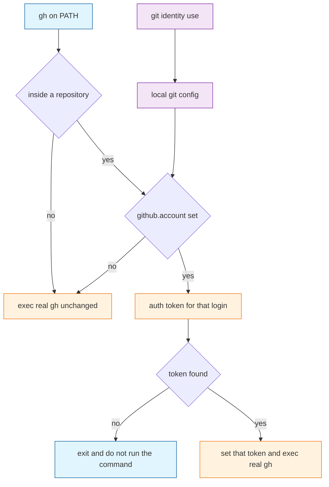

# Task: gh account pin

* Task ID: gh-account-pin
* Complexity: Level 3
* Type: feature

`git identity use` records the GitHub login for a checkout. A `gh` shim on `PATH` forces that login's token for the real `gh`. Linked worktrees read the same local git config. The approach is the one in `memory-bank/active/creative/creative-gh-account-per-checkout.md`.

Real GitHub logins, SSH hosts, account names, and tokens do not appear in this repository. Tests and docs use placeholders such as `example-login` and `ghe.example`. Tests stub `gh`. They do not run the operator's real `gh`, read `~/.config/gh`, or install into the operator's real home.

## Pinned Info

### How a gh command picks its token

The shim is the `gh` on `PATH`. The pin is local git config, which a linked worktree already shares with the core checkout.

## Component Analysis

### Affected Components

- `subcommands/git-identity/git-identity.bash`: applies an identity file to the current checkout. Gains `@gh-account` and `@gh-host`. Clears those keys when the identity file omits them.
- `shims/gh.sh`: new POSIX shim, installed as `~/.local/bin/gh`. Reads the pin and execs the real `gh`.
- `scripts/install-subcommands.sh`: copies git subcommands into `~/.local/bin` and writes their cat pages. Also installs, parks, and uninstalls the shim. `make`, `make subcommands`, and `make clean` already call this script.
- `subcommands/git-identity/README.md`: documents identity directives.
- `memory-bank/productContext.md` and `memory-bank/systemPatterns.md`: one sentence each so the product picture and the install story stay true.

### Cross-Module Dependencies

- `git identity use` writes `github.account` and `github.host`. It does not call `gh`.
- The shim reads those keys with `git config --get` and calls the real `gh`. It does not call `git identity`.
- The installer copies `shims/gh.sh` to `~/.local/bin/gh`. The shim then finds the real binary at `~/.local/libexec/git-aliases/gh` or as the next `gh` on `PATH`.
- `@hostname` still rewrites SSH remotes inside `git-identity`. The shim does not read that alias.

### Boundary Changes

- Identity files gain two optional directives, `@gh-account` and `@gh-host`.
- Default install adds `~/.local/bin/gh`. A foreign file already at that path is moved to `~/.local/libexec/git-aliases/gh`.
- No git config schema beyond the two local keys. Plain `git config`, never `git config --worktree`.

### Invariants & Constraints

- A pin with no stored token must not fall through to the active account.
- The shim must not call `gh auth switch` and must not print a token.
- No pin, and not a repository, both leave the environment unchanged.
- `@hostname` is not passed as `--hostname`.
- Tests and build verification stay inside a fake `HOME`. Do not run `make`, `make subcommands`, or `make clean` against the operator's real home.
- Placeholders only. No real identities in source, tests, docs, or the memory bank.
- Linux and macOS. No `cmd` or PowerShell shim in this pass.
- No new runtime dependency.

## Open Questions

- [x] How should a checkout force `gh` onto one account, including worktrees, without a shell hook? → Resolved: PATH shim plus `github.account` written by `git identity` (see `memory-bank/active/creative/creative-gh-account-per-checkout.md`)
- [x] Does the implementation live in this repository? → Resolved: yes. The accepted design changes `git identity`, which is this product.

None unresolved.

## Test Plan (TDD)

### Behaviors to Verify

- `git identity use` with `@gh-account example-login` → `github.account` is `example-login`
- `git identity use` of an identity with no `@gh-account`, after a pin was set → `github.account` is unset
- `@gh-host ghe.example` → `github.host` is `ghe.example`, and a later identity with no `@gh-host` unsets it
- `@hostname vanity.example` on an SSH remote → the remote host becomes `vanity.example` and `github.host` stays unset
- `@gh-account` with an empty value → `git identity use` exits non-zero and does not set `github.account`
- `git identity use` on the core checkout → a linked worktree's `git config --get github.account` returns the same login
- Shim, repository, no pin, `GH_TOKEN` already set → the stub `gh` sees that same `GH_TOKEN` and the original arguments
- Shim, not a repository, `GH_TOKEN` already set → same passthrough
- Shim, pin `example-login`, ambient `GH_TOKEN` and `GITHUB_TOKEN` set → lookup is `auth token --user example-login` with no `--hostname`; the command runs with `GH_TOKEN` equal to the stub token and `GITHUB_TOKEN` empty
- Shim, pin whose token lookup exits non-zero → shim exits non-zero, stderr names the login, the requested command is not run, stdout has no token
- `github.host` is `ghe.example` → lookup includes `--hostname ghe.example`, and the command runs with `GH_ENTERPRISE_TOKEN` set and `GH_TOKEN` empty
- Remote host is `vanity.example` and `github.host` is unset → lookup has no `--hostname`
- Pin set on the core checkout, shim invoked in the linked worktree → the stub sees that login
- `~/.local/libexec/git-aliases/gh` exists and another `gh` is later on `PATH` → the libexec binary is the one invoked
- Stub treats `auth switch` as a failure if it is ever invoked
- Install under a fake home → `~/.local/bin/gh` is the shim
- Install when `~/.local/bin/gh` is a foreign file → that file's bytes move to `~/.local/libexec/git-aliases/gh` and `~/.local/bin/gh` is the shim
- Install again → the parked bytes are unchanged
- Install when a foreign `~/.local/bin/gh` and a parked file both exist → installer exits non-zero and both files stay
- Uninstall after a park → shim is gone and the parked bytes are back at `~/.local/bin/gh`
- Uninstall when `~/.local/bin/gh` is foreign and nothing is parked → that file stays

### Test Infrastructure

- Framework: the repo's POSIX shell suites (`set -eu`, `run_isolated`, fake `HOME`, `GIT_CONFIG_GLOBAL=/dev/null`)
- Test location: `tests/`
- Conventions: one `test_*` function per behavior, `run_one` from `main`, placeholders only, copy the script under test onto a temp `PATH` and `chmod +x` it. `tests/test-git-identity.sh` and `tests/test-install-subcommands.sh` are the patterns. Do not add a shunit2 suite for this feature.
- New test files: `tests/test-gh-shim.sh`
- Existing files that gain cases: `tests/test-git-identity.sh`, `tests/test-install-subcommands.sh`
- `Makefile` `test` target must run `tests/test-gh-shim.sh`

### Integration Tests

- Worktree pin: `git identity use` on the core checkout, then the shim in the linked worktree, against a stub `gh`
- Installer copies `shims/gh.sh` and the shim's libexec-versus-PATH rule. The install tests stay in the fake home and use a foreign stand-in file, not a real `gh` binary

## Implementation Plan

### 1. git-identity directives — executable

- Files: `tests/test-git-identity.sh`, `subcommands/git-identity/git-identity.bash`
- Creative ref: `memory-bank/active/creative/creative-gh-account-per-checkout.md`

1. Stub tests: add `test_use_sets_github_account`, `test_use_without_gh_account_clears_pin`, `test_use_sets_github_host`, `test_hostname_does_not_set_github_host`, `test_gh_account_empty_fails`, and `test_worktree_sees_github_account`, each with an empty body, and call them from `run_one`.
2. Stub interface: in `process_directive`, add `gh-account` and `gh-host` arms that return without writing config. In `use_identity`, add the two "directive was seen" flags, still unused.
3. Write tests and run red: drive `git identity use` against identity files created inside the isolated home. Assert the `github.account` and `github.host` outcomes above, including the worktree read and the empty-value failure. Run `tests/test-git-identity.sh` and see the new cases fail.
4. Write code and run green: `gh-account` runs `git config --replace-all github.account` with the login. `gh-host` does the same for `github.host`. After the identity file is applied, a missing `@gh-account` runs `git config --unset github.account`, and a missing `@gh-host` unsets `github.host`. A missing key is not an error. An empty directive value exits non-zero before any write. Update the `create` template with commented placeholder directives. Do not assert on the template text. Run `tests/test-git-identity.sh` until the new cases and the existing ones pass.

### 2. gh shim — executable

- Files: `tests/test-gh-shim.sh`, `shims/gh.sh`, `Makefile`
- Creative ref: `memory-bank/active/creative/creative-gh-account-per-checkout.md`

1. Stub tests: create `tests/test-gh-shim.sh` in the same isolated-home style as `tests/test-git-identity.sh`. Add empty cases for the shim behaviors listed above, including libexec precedence, the vanity remote, the enterprise host, the missing token, and the worktree. Add the file to the `Makefile` `test` target.
2. Stub interface: add `shims/gh.sh` with `#!/bin/sh`, the marker comment `git-aliases-gh-shim`, and empty `resolve_real_gh`, `exec_real`, and `main`. Follow `shell-posix-style`. The installed name has no extension. The source name is `gh.sh` so ShellCheck sees it.
3. Write tests and run red: the stub `gh` on `PATH` records arguments and the four token variables to files under the fake home. `auth token --user example-login` prints `test-token`. `auth token --user missing-login` exits 1. Any `auth switch` exits 1. `PATH` in the test is the shim directory, then the stub directory, then `/usr/bin:/bin`. Run `tests/test-gh-shim.sh` and see the new cases fail. The suite must refuse to run when `HOME` is the operator's home.
4. Write code and run green. `resolve_real_gh` uses `~/.local/libexec/git-aliases/gh` when that file is executable. Otherwise it walks `PATH` with `IFS=:` so entries that contain spaces stay intact, skips the directory of the running script, and takes the first executable `gh`. No real binary: exit non-zero. Outside a repo, or when `github.account` is unset, exec the real binary with the environment unchanged. When it is set, unset `GH_TOKEN`, `GITHUB_TOKEN`, `GH_ENTERPRISE_TOKEN`, and `GITHUB_ENTERPRISE_TOKEN`, then run `auth token --user` on the real binary, adding `--hostname` only from `github.host`. A failed or empty lookup exits non-zero and names the login. On success, export `GH_TOKEN` when the host is unset, `github.com`, or ends in `.ghe.com`. Export `GH_ENTERPRISE_TOKEN` for any other host. Exec the real binary. Do not print the token. Do not call `auth switch`. Run `tests/test-gh-shim.sh` and `shellcheck --severity=error shims/gh.sh`.

### 3. Install and uninstall — executable

- Files: `tests/test-install-subcommands.sh`, `scripts/install-subcommands.sh`
- Creative ref: `memory-bank/active/creative/creative-gh-account-per-checkout.md`

1. Stub tests: add empty `test_install_places_shim`, `test_install_parks_foreign_gh`, `test_reinstall_preserves_parked_gh`, `test_install_refuses_second_foreign_gh`, `test_uninstall_restores_parked_gh`, and `test_uninstall_leaves_foreign_gh` to the existing installer suite, and call them from `run_one`.
2. Stub interface: add `install_gh_shim` and `uninstall_gh_shim` in `scripts/install-subcommands.sh` with the function signatures and comments, and call them from the install and uninstall branches. Bodies return 0 without copying files.
3. Write tests and run red: under the suite's fake home, a foreign `~/.local/bin/gh` is a small text file with known bytes. Assert park, restore, reinstall, and the refusal when both a foreign `gh` and a parked file exist. Run `tests/test-install-subcommands.sh` and see the new cases fail.
4. Write code and run green. The shim marker is the comment `git-aliases-gh-shim`. Install over an existing shim refreshes `~/.local/bin/gh` from `shims/gh.sh` and does not touch the parked file. Install over a foreign file moves it to `~/.local/libexec/git-aliases/gh` when that path is absent, then copies the shim. When the parked path already exists, exit non-zero and leave both files. Uninstall removes `~/.local/bin/gh` only when it contains the marker, then moves the parked file back. A foreign `~/.local/bin/gh` with nothing parked is left in place. Do not route the shim through the subcommand `-h` / cat-page loop. Run `tests/test-install-subcommands.sh` until the new cases and the existing ones pass.

### 4. Docs — prose/policy

- Files: `subcommands/git-identity/README.md`, `memory-bank/productContext.md`, `memory-bank/systemPatterns.md`
- No tests: prose/policy artifact
- Creative ref: `memory-bank/active/creative/creative-gh-account-per-checkout.md`

1. In the identity README, document `@gh-account` and `@gh-host` next to `@hostname`. State that `@hostname` is the SSH alias and `@gh-host` is the API host. Use placeholder logins and hosts only.
2. In `memory-bank/productContext.md`, extend the identity use case by one sentence: an identity can also name the GitHub login `gh` should use for that checkout.
3. In `memory-bank/systemPatterns.md`, add one sentence to the install description: `make subcommands` also installs the `gh` shim from `shims/gh.sh` and parks a foreign `~/.local/bin/gh` under `~/.local/libexec/git-aliases/`.

## Technology Validation

No new technology - validation not required. Runtime already has git and `gh`. Tests use a stub `gh`. ShellCheck is already how `*.sh` is checked.

## Challenges & Mitigations

- Ambient `GH_TOKEN` could be what `gh auth token` returns, so the pin would be fake. Checked on the installed `gh`: `GH_TOKEN=obviously-fake gh auth token --user nosuchuser-example` exits 1 and does not print the ambient value. The shim still unsets all four token variables before the lookup so a later `gh` cannot change that.
- `PATH` entries contain spaces. Walk with `IFS=:` and do not echo the unquoted path through `sed`.
- `$0` may be a bare `gh`. Skip the shim by comparing the candidate path with the running script, and prefer the libexec path when it exists.
- `git config --unset` exits 5 when the key is absent. Treat that as success inside `use_identity`. The script has no `set -e` today. Keep the unset from failing the switch.
- A real `make subcommands` would park whatever is at `~/.local/bin/gh` in the operator's home. Build verification is `make test` and `shellcheck --severity=error shims/gh.sh`. The install tests use the suite's fake home.
- Test output could echo a real token if a test reached the real `gh`. The shim suite puts only the stub on `PATH` and uses the fixed string `test-token`.
- `github.host` for GitHub Enterprise Server has to ride `GH_ENTERPRISE_TOKEN`, because `GH_TOKEN` applies to github.com and `*.ghe.com`. The shim picks the variable from the host. The test uses `ghe.example`.

## Pre-Mortem

- A test or a doc recorded a real login or host, and that landed in git. The plan allows placeholders only, and the shim suite never calls the real `gh`. Review the diff for that before the build phase ends.
- Development ran the installer in the real home and parked the operator's `gh`. Already covered by the "fake HOME only" challenge. The pre-mortem addition is that `shims/gh.sh` resolves libexec under `HOME`, so a shim test that forgets the existing "refused to run without isolated HOME" guard would talk to the real home. The new suite uses that same guard.
- The feature shipped in this repository and the operator wanted it only as a design note. Placement is recorded in the brief and in Open Questions. Build waits for `/niko-build`.

## Status

- [x] Component analysis complete
- [x] Open questions resolved
- [x] Test planning complete (TDD)
- [x] Implementation plan complete
- [x] Technology validation complete
- [x] Pre-Mortem complete
- [ ] Preflight
- [ ] Build
- [ ] QA
